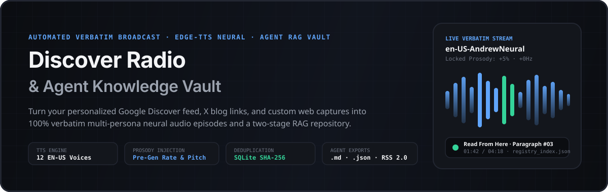
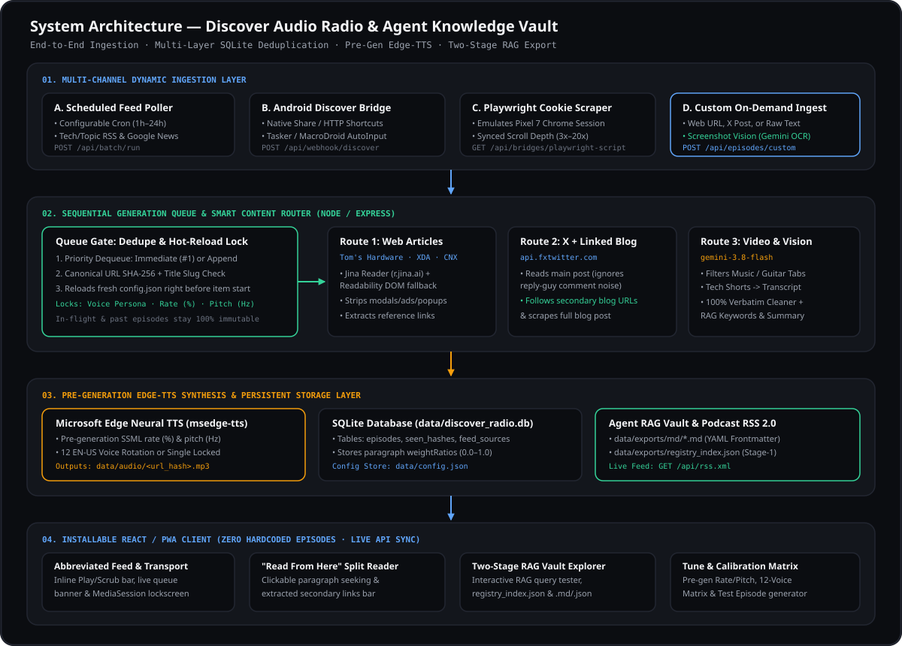
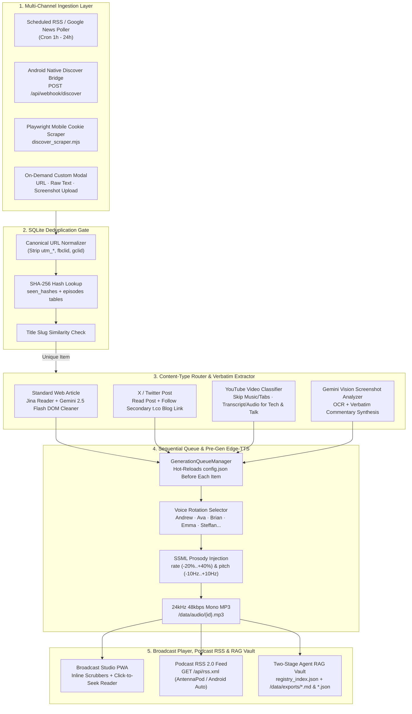
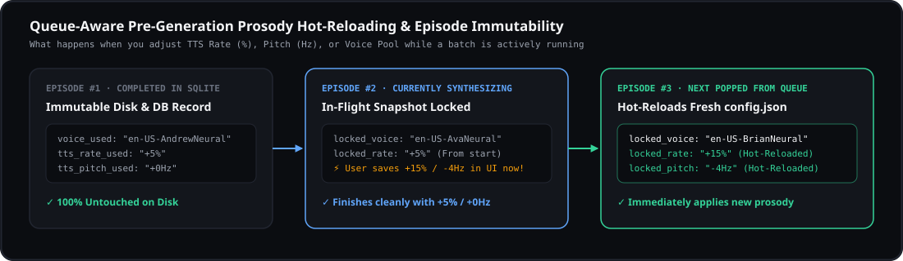
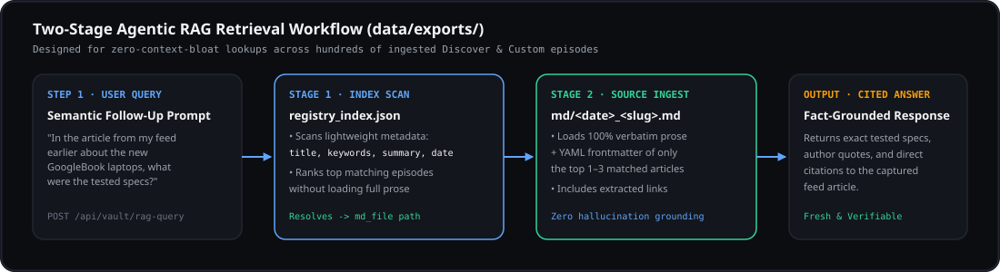
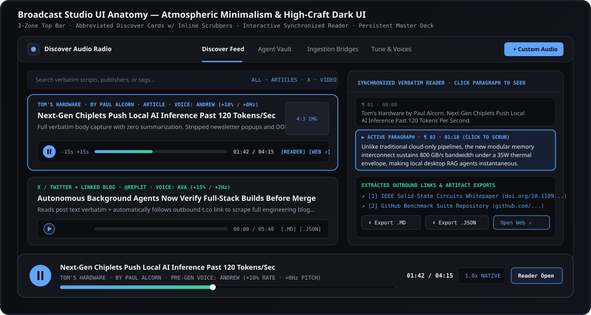

<div align="center">



# Discover Radio: Audio Feed & Agent Knowledge Vault

**Automated Verbatim Audio-Readthrough Broadcast, Pre-Generation Neural Voice Engine, and Two-Stage RAG Knowledge Vault for Google Discover & Web Feeds**

[](./tsconfig.json)
[](./server.ts)
[](./src/server/ttsAndScraper.ts)
[](./src/server/ttsAndScraper.ts)
[](./vite.config.ts)

[**System Architecture**](./docs/ARCHITECTURE.md) · [**REST API & RAG Vault Spec**](./docs/API_AND_RAG_VAULT.md) · [**Android & Playwright Ingestion Bridges**](./docs/BRIDGES_AND_AUTOMATION.md) · [**Source Video Concept Matrix**](./.aistudio/artifacts/brain/11dfa890-62cc-41cf-baeb-302f84368512/source_video_transcription.md)

</div>

---

## 1. Overview & Motivation

Scrolling through **Google Discover** on Android surfaces high-signal articles (*Tom's Hardware*, *XDA Developers*, *TechRadar*, *Ars Technica*), **X (Twitter) engineering threads** that link out to full blog posts, and **YouTube tech videos**. However, consuming that feed on the go faces four major friction points:

1. **Ad-Cluttered Web Layouts**: Opening mobile links triggers newsletter modals, sticky video overlays, "See More" expanders, and inline ad carousels.
2. **AI Summarization Loss**: Typical "AI podcast" generators summarize away the actual engineering benchmarks, code details, and nuance. **You want the full article read verbatim—not an AI summary.**
3. **Heterogeneous Media Routing**: X posts often contain a short teaser plus an outbound `t.co` link to the real article; YouTube links mix talk-show clips and tech reviews with music/guitar tabs that should be skipped.
4. **Ephemeral Knowledge Loss**: Five days after listening to an article, you or your AI coding agents (`Claude Code`, `Cursor`, custom MCP tools) need to recall that exact article without bloating the LLM context window.

**Discover Radio: Audio Feed & Agent Knowledge Vault** solves all four problems in a unified, zero-mock full-stack application:

- **Verbatim Broadcast Script Formatting**: Every ingested item starts with a standardized broadcast header (`"[Source] by [Author]. [Title]."`), followed by the **complete verbatim article body** stripped of DOM noise.
- **Pre-Generation Neural TTS & Voice Rotation**: Uses Microsoft Edge Neural `en-US` voices (`msedge-tts`) with native SSML `<prosody rate="..." pitch="...">` synthesis baked directly into the `.mp3` before playback—never browser pitch-warping.
- **Sequential Queue with Mid-Batch Config Hot-Reload**: Adjust speech rate, pitch, or voice pool while a batch is generating; the queue worker reloads `config.json` right before synthesizing the next item.
- **Two-Stage Agent RAG Vault**: Automatically exports every episode as `.md` (YAML frontmatter + verbatim text), `.json` (structured metadata + extracted links), and updates a lightweight `registry_index.json` so AI agents can filter hundreds of articles before loading only the 1–2 relevant files.

---

## 2. System Architecture



For a deep dive into database schemas, state machines, and component interactions, see [**`docs/ARCHITECTURE.md`**](./docs/ARCHITECTURE.md).

### High-Level Pipeline Flow (Mermaid)



---

## 3. Core Engineering Capabilities

### 3.1 Sequential Generation Queue & Pre-Generation Prosody



Unlike naive web players that apply HTML5 `audio.playbackRate` time-stretching in the browser (which introduces metallic phase artifacts), **Discover Radio** applies rate (`-20%` to `+40%`) and pitch (`-10Hz` to `+10Hz`) inside the SSML `<prosody>` envelope during neural synthesis:

```xml
<speak version="1.0" xmlns="http://www.w3.org/2001/10/synthesis" xml:lang="en-US">
  <voice name="en-US-AndrewNeural">
    <prosody rate="+10%" pitch="+0Hz">
      Tom's Hardware by Paul Alcorn. Next-Gen Chiplets Push Local AI Inference...
    </prosody>
  </voice>
</speak>
```

- **Mid-Batch Hot-Reload**: When 10 articles are queued, `GenerationQueueManager` processes them sequentially (`1..N`). At the start of item `k`, the worker calls `getConfig()` from disk, locking a fresh `ConfigSnapshot` for item `k` without mutating items `1..k-1`.
- **Automatic Voice Rotation**: Each consecutive article rotates to a different `en-US` neural persona (`Andrew`, `Ava`, `Brian`, `Emma`, `Christopher`, `Aria`, `Eric`, `Michelle`, `Roger`, `Steffan`) so multi-article listening sessions have clear sonic boundaries between stories.

---

### 3.2 Two-Stage Agent Knowledge Vault & RAG Export



Every synthesized episode writes three synchronized artifacts to `/data/exports/`:

1. **`/data/exports/registry_index.json`**: Compact manifest containing `id`, `title`, `sourceName`, `author`, `createdAt`, `keywords[]`, `summary1Line`, and file paths.
2. **`/data/exports/{date}-{slug}.md`**: Markdown file with YAML frontmatter (`id`, `url`, `voice_id`, `prosody_rate`, `keywords`, `extracted_links`) and the complete verbatim body.
3. **`/data/exports/{date}-{slug}.json`**: Machine-readable JSON payload with `paragraphs[]` (including character offsets and proportional `weightRatio` timestamps) and `extractedLinks[]`.

---

### 3.3 Broadcast Studio UI & Synchronized Reader



Designed with **Atmospheric Minimalism & High-Craft Dark UI** (`#0B0D11` carbon slate canvas, `#13161C` elevated cards, `#60A5FA` broadcast signal blue, and tabular `JetBrains Mono` timecodes):

- **Abbreviated Feed Stream**: Cards show source badge, author, title, 2-line preview, `4:3` thumbnail, and an inline transport bar (`Play/Pause`, `-15s`, `+15s`, live scrubber, `MM:SS / MM:SS`, `.md`/`.json` download, and external web link).
- **Interactive Click-to-Seek Reader**: Clicking any paragraph `¶` in the Reader Pane jumps the audio player directly to that paragraph's proportional timestamp (`weightRatio * durationSec`) and highlights the active paragraph while playing.
- **On-Demand `+ Custom Audio` Modal**: Paste any URL, raw text, or upload a mobile screenshot to generate a custom audio episode on the fly.

---

## 4. Repository Structure

```text
.
├── server.ts                         # Express + Vite full-stack server, Queue Worker, REST APIs, Cron Scheduler
├── src/
│   ├── types.ts                      # Shared TypeScript interfaces (Episode, AppConfig, RegistryIndex, QueueStatus)
│   ├── App.tsx                       # Main application state, HTML5 Audio controller, MediaSession API sync
│   ├── index.css                     # Tailwind v4 configuration, custom typography & theme tokens
│   ├── server/
│   │   ├── db.ts                     # Node 22 native SQLite (with JSON mirror), SHA-256 deduplication, Vault exporter
│   │   ├── ttsAndScraper.ts          # Edge-TTS neural synthesizer, Jina/Readability scraper, X link follower, Vision OCR
│   │   └── voices.ts                 # 10 en-US Edge-TTS neural voice personas & default feed configurations
│   ├── components/
│   │   ├── TopBar.tsx                # 3-Zone Top Bar navigation & live synthesis status indicator
│   │   ├── FeedView.tsx              # Abbreviated Discover feed cards, search/filter bar, inline transport controls
│   │   ├── ReaderPane.tsx            # Synchronized verbatim reader with click-to-seek paragraphs & extracted links
│   │   ├── MasterPlayer.tsx          # Persistent bottom audio transport deck with immutable prosody readout
│   │   ├── VaultView.tsx             # Two-Stage Agent Knowledge Vault explorer, RAG test console & artifact downloads
│   │   ├── BridgesView.tsx           # Podcast RSS feed URL, Android Webhook tester, Playwright scraper generator
│   │   ├── TuneModal.tsx             # Pre-Generation prosody sliders, voice pool selector, Feed CRUD manager
│   │   └── CustomIngestModal.tsx     # On-demand URL, raw text, and Gemini Vision screenshot upload modal
│   └── hooks/
│       └── usePWAInstall.ts          # Installable PWA prompt & online connectivity hooks
├── docs/
│   ├── ARCHITECTURE.md               # Detailed system architecture, data models, and sequence diagrams
│   ├── API_AND_RAG_VAULT.md          # Complete REST API reference & AI Agent / MCP integration guide
│   ├── BRIDGES_AND_AUTOMATION.md     # Android Tasker/MacroDroid webhook guide & Playwright mobile scraper setup
│   └── assets/                       # Custom SVG architectural & UI diagrams
│       ├── hero-banner.svg
│       ├── architecture-diagram.svg
│       ├── queue-prosody-lifecycle.svg
│       ├── rag-two-stage-flow.svg
│       └── ui-layout-anatomy.svg
└── data/                             # Runtime SQLite database, synthesized MP3s, and RAG Vault exports (gitignored)
    ├── discover_radio.db
    ├── config.json
    ├── audio/                        # Synthesized 24kHz 48kbps mono .mp3 episodes
    └── exports/                      # registry_index.json + {date}-{slug}.md & .json files
```

---

## 5. Quickstart & Installation

### Prerequisites

- **Node.js**: `v22.5.0+` (uses built-in `node:sqlite` with automatic transactional JSON mirror fallback)
- **Gemini API Key**: Required for DOM ad-clutter stripping, screenshot Vision OCR, and semantic RAG synthesis (`GEMINI_API_KEY`)

### 1. Clone & Install Dependencies

```bash
git clone https://github.com/your-org/discover-audio-radio.git
cd discover-audio-radio
npm install
```

### 2. Configure Environment Variables

Copy `.env.example` to `.env` and add your `GEMINI_API_KEY`:

```bash
cp .env.example .env
```

```ini
# .env
GEMINI_API_KEY="your_gemini_api_key_here"
APP_URL="http://localhost:3000"
```

### 3. Run in Development or Production

```bash
# Start full-stack Express + Vite server on http://localhost:3000
npm run dev

# Build frontend production bundle
npm run build

# Start production server
npm start
```

---

## 6. Key API Endpoints at a Glance

| Method | Endpoint | Description |
| :--- | :--- | :--- |
| `GET` | `/api/episodes` | List all synthesized episodes, queue status (`queued`, `processing`), and active `AppConfig` |
| `POST` | `/api/ingest` | Enqueue a custom URL, raw text block, or X/YouTube link for verbatim synthesis |
| `POST` | `/api/ingest/screenshot` | Upload an image (`multipart/form-data`) for Gemini Vision OCR & verbatim audio synthesis |
| `POST` | `/api/webhook/discover` | Native Android Share / Tasker / Playwright webhook (`{ url }` or `{ urls: [] }`) |
| `POST` | `/api/feeds/poll` | Immediately poll all enabled RSS / Google News sources and enqueue new articles |
| `GET` | `/api/vault/index` | Retrieve the lightweight Stage-1 `registry_index.json` manifest for AI agents |
| `POST` | `/api/vault/query` | Execute a Two-Stage RAG search (`{ query }`) across the Vault with source citations |
| `GET` | `/api/rss.xml` | Standard Podcast RSS 2.0 feed with `<enclosure>` MP3 links for AntennaPod / Pocket Casts |
| `GET` | `/api/bridges/playwright-script` | Download the standalone `discover_scraper.mjs` mobile cookie automation script |

Full request/response payloads and `curl` examples are documented in [**`docs/API_AND_RAG_VAULT.md`**](./docs/API_AND_RAG_VAULT.md).

---

## 7. Supporting Documentation

- [**System Architecture (`docs/ARCHITECTURE.md`)**](./docs/ARCHITECTURE.md): Deep dive into the 5 architectural layers, SQLite database schema, content-type routing logic, and sequential TTS worker state machine.
- [**API & Agent RAG Vault (`docs/API_AND_RAG_VAULT.md`)**](./docs/API_AND_RAG_VAULT.md): Complete REST endpoint documentation, `.md`/`.json` file specifications, and Python/TypeScript snippets for connecting Claude Code or MCP agents to your Vault.
- [**Android & Playwright Bridges (`docs/BRIDGES_AND_AUTOMATION.md`)**](./docs/BRIDGES_AND_AUTOMATION.md): Step-by-step instructions to connect your Android phone's native Share sheet, MacroDroid/Tasker automation, Playwright mobile cookie scraper, and Podcast RSS player.

---

## License

Apache-2.0
