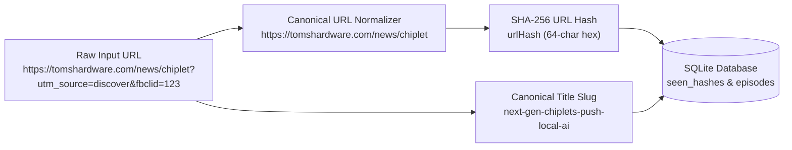
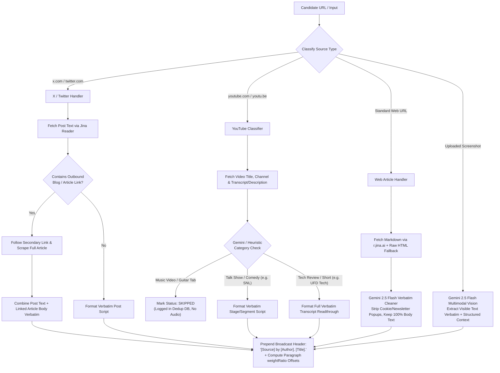
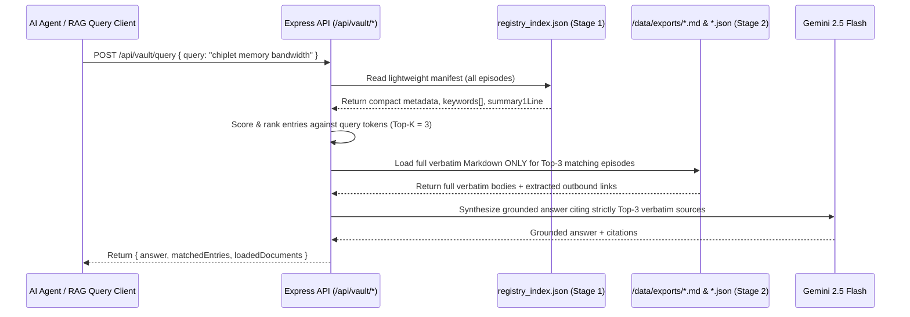

# System Architecture & Engineering Specification


This document details the internal architecture, data models, deduplication algorithms, content routing heuristics, and neural speech synthesis pipeline powering **Discover Radio: Audio Feed & Agent Knowledge Vault**.

---

## 1. Architectural Principles

1. **Zero Hardcoded Content**: The frontend contains zero static or mock episodes. Every card, audio stream, transcript paragraph, and RAG artifact is dynamically ingested, deduplicated in SQLite, synthesized via Edge-TTS, and persisted to `/data/`.
2. **Verbatim Fidelity Over Summarization**: Standard articles are read word-for-word from start to finish prefixed with a clean broadcast announcement (`"[Source] by [Author]. [Title]."`). AI is used strictly to strip newsletter modals, navigation chrome, and inline ads—never to condense the author's prose.
3. **Pre-Generation Prosody**: Speech rate (`-20%` to `+40%`) and pitch (`-10Hz` to `+10Hz`) are baked into the neural waveform during synthesis via SSML `<prosody>` tags.
4. **Mid-Batch Configuration Hot-Reload**: Changing voice pool, rate, or pitch in the UI updates `/data/config.json` immediately. The sequential queue worker reloads `/data/config.json` right before synthesizing the next queued item.
5. **Context-Window Safe RAG**: Rather than stuffing hundreds of full articles into an LLM prompt, every episode writes a compact entry to `/data/exports/registry_index.json` alongside full `.md` and `.json` files for Two-Stage retrieval.

---

## 2. Multi-Layer Deduplication & Persistence Schema

### 2.1 URL Normalization & Hashing (`src/server/db.ts`)

Before any URL is scraped or synthesized, `normalizeUrl()` strips tracking parameters (`utm_source`, `utm_medium`, `utm_campaign`, `utm_term`, `utm_content`, `fbclid`, `gclid`, `mc_cid`, `mc_eid`, `ref`, `s`, `t`), removes trailing slashes, and lowercases the hostname.



An incoming candidate item is rejected as a duplicate if **either**:
1. Its `urlHash` exists in `seen_hashes` or `episodes.urlHash`, **OR**
2. Its normalized `titleSlug` (for titles > 12 chars) matches an existing episode in `episodes`.

### 2.2 SQLite Relational Schema (`data/discover_radio.db`)

The persistence layer uses Node.js 22's built-in `node:sqlite` (`DatabaseSync`) with WAL mode enabled, paired with an automatic transactional JSON mirror (`data/episodes_store.json`) for portability across container restarts.

```sql
CREATE TABLE IF NOT EXISTS episodes (
  id TEXT PRIMARY KEY,
  url TEXT NOT NULL,
  urlHash TEXT NOT NULL UNIQUE,
  titleSlug TEXT NOT NULL,
  title TEXT NOT NULL,
  sourceName TEXT NOT NULL,
  sourceDomain TEXT NOT NULL,
  author TEXT NOT NULL,
  publishedAt TEXT NOT NULL,
  createdAt TEXT NOT NULL,
  contentType TEXT NOT NULL,        -- 'article' | 'x_post' | 'youtube_transcript' | 'youtube_audio' | 'custom_text' | 'screenshot'
  status TEXT NOT NULL,             -- 'queued' | 'processing' | 'ready' | 'skipped' | 'error'
  skipReason TEXT,
  voiceId TEXT NOT NULL,
  voiceName TEXT NOT NULL,
  prosodyRate TEXT NOT NULL,        -- e.g. '+10%'
  prosodyPitch TEXT NOT NULL,       -- e.g. '+0Hz'
  durationSec REAL NOT NULL,
  wordCount INTEGER NOT NULL,
  summary1Line TEXT NOT NULL,
  keywordsJson TEXT NOT NULL,       -- JSON string[]
  verbatimScript TEXT NOT NULL,     -- Full broadcast script read by Edge-TTS
  paragraphsJson TEXT NOT NULL,     -- JSON ParagraphSegment[] with proportional weightRatio
  extractedLinksJson TEXT NOT NULL, -- JSON ExtractedLink[]
  audioUrl TEXT NOT NULL,           -- '/api/audio/{id}.mp3'
  mdExportPath TEXT NOT NULL,       -- '/api/vault/export/{date}-{slug}.md'
  jsonExportPath TEXT NOT NULL,     -- '/api/vault/export/{date}-{slug}.json'
  thumbnailUrl TEXT
);

CREATE TABLE IF NOT EXISTS seen_hashes (
  urlHash TEXT PRIMARY KEY,
  url TEXT NOT NULL,
  titleSlug TEXT NOT NULL,
  seenAt TEXT NOT NULL
);

CREATE TABLE IF NOT EXISTS feed_sources (
  id TEXT PRIMARY KEY,
  name TEXT NOT NULL,
  url TEXT NOT NULL,
  category TEXT NOT NULL,
  enabled INTEGER NOT NULL DEFAULT 1,
  lastPolledAt TEXT
);
```

---

## 3. Content-Type Routing & Extraction Engine (`src/server/ttsAndScraper.ts`)

Google Discover surfaces heterogeneous media. When a URL enters the pipeline, `classifyAndExtractUrl()` classifies the URL and executes specialized extraction logic:



### Proportional Paragraph Timestamp Calculation

To enable instant **"Read from here"** scrubbing in the Reader Pane without requiring heavy forced-alignment phoneme models, `buildParagraphSegments()` computes each paragraph's character span and assigns a normalized `weightRatio` $\in [0.0, 1.0)$:

$$\text{weightRatio}_i = \frac{\sum_{k=0}^{i-1} \text{charLength}(P_k)}{\sum_{k=0}^{N-1} \text{charLength}(P_k)}$$

During playback, the active paragraph is highlighted when `currentTime / duration >= paragraph.weightRatio`, and clicking paragraph $i$ seeks the HTML5 `<audio>` element directly to:

$$t_{\text{seek}} = \text{weightRatio}_i \times \text{durationSec}$$

---

## 4. Sequential Queue & Pre-Generation Neural TTS Lifecycle


### Why Sequential Processing Matters

1. **Hot-Reloading Prosody & Voices Mid-Batch**: If a user queues 8 articles and decides during article #2 that the speech rate should be `+15%` instead of `+5%`, saving settings updates `/data/config.json`. Because `GenerationQueueManager` pulls one item at a time from its queue and calls `getConfig()` immediately prior to synthesis, articles #3 through #8 automatically adopt `+15%`.
2. **Deterministic Voice Rotation**: `selectNextVoice(config)` checks `config.lastVoiceIndex`, advances to `(index + 1) % enabledVoices.length`, persists the updated pointer, and guarantees consecutive articles never share the same voice unless only one voice is enabled.
3. **Chunked Neural Streaming**: Long-form articles (e.g., 3,500-word hardware reviews) are split along paragraph boundaries into `< 2,800` character chunks, synthesized via `MsEdgeTTS` (`AUDIO_24KHZ_48KBITRATE_MONO_MP3`), and concatenated into a seamless MP3 stream on disk (`/data/audio/{id}.mp3`).

---

## 5. Two-Stage Agent RAG Vault Architecture



